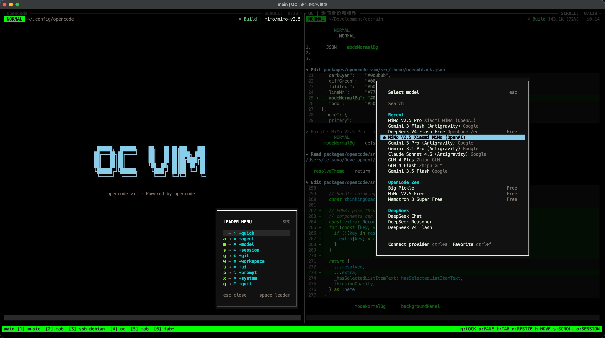

# opencode-vim

A LazyVim-inspired Vim TUI frontend for [opencode](https://github.com/anomalyco/opencode) — an open-source AI-powered development tool.

This fork maintains a Vim-first minimal TUI (`packages/opencode-vim/`) on top of OpenCode 2 (`upstream/dev`), keeping upstream changes confined to a single seam file (`packages/tui/src/app.tsx`) for low-conflict syncing.



## Fork Features

- **Vim Modes** — Insert (`i`/`a`) and Normal (`<Esc>`) mode workflow for keyboard-first navigation
- **Leader Menu** — Right-side popup shortcut menu (`<Space>` in Normal mode) inspired by LazyVim
- **Minimal Root Takeover** — Replaces `Home` and `Session` routes with compact `MinimalHome` and `MinimalSession` views while suppressing upstream chrome (`SessionTabs`, `DevToolsBar`, `DialogHighlights`)
- **Compact Interface** — Streamlined layout with model info, token usage, Vim mode indicator, and inline spinner
- **Slash & File Autocomplete** — Bottom-anchored `/` and `@` autocomplete popup driven by OpenCode 2's `Keymap.createLayer`
- **Single-Seam Upstream Integration** — Only `packages/tui/src/app.tsx` has a `FORK-SEAM (opencode-vim)` block; all other fork logic lives in `packages/opencode-vim/`

## Building

```bash
bash fork/build.sh
```

Builds the Vim plugin bundle (`fork/dist/plugin/`) and standalone binaries in `fork/dist/opencode-<os>-<arch>/bin/`:
- `opencode`
- `opencode-vim`

## Running

```bash
./fork/dist/opencode-linux-x64/bin/opencode-vim [project]
```

Or in development:

```bash
bun run --cwd packages/cli src/index.ts [project]
```

## Validation & Testing

```bash
# 1. Verify upstream seam boundaries (only packages/tui/src/app.tsx allowed)
bash fork/check-upstream-seams.sh

# 2. Run opencode-vim unit tests and typecheck
cd packages/opencode-vim && bun test && bun run typecheck

# 3. Run TUI typecheck
cd packages/tui && bun run typecheck

# 4. Verify plugin load and build binaries
bash fork/build.sh
```

## Syncing with Upstream

```bash
bash fork/update.sh
```

Fetches `upstream/dev`, rebases the fork branch onto `upstream/dev`, resolves `bun.lock` automatically via `bun install`, and leaves any seam conflicts ready for inspection. See [`fork/AGENTS.md`](./AGENTS.md) and [`fork/docs/202610240935_opencode-v2-vim-migration-and-maintenance-guide.md`](./docs/202610240935_opencode-v2-vim-migration-and-maintenance-guide.md) for the complete developer and sync workflow.

## Monorepo Package Overview (OpenCode 2)

| Package | Description |
|---------|-------------|
| `packages/cli` | CLI binary entrypoint (`@opencode/cli`) |
| `packages/tui` | Upstream OpenTUI + SolidJS terminal UI (`@opencode/tui`) |
| `packages/opencode` | Core runtime & server (`opencode`) |
| `packages/core` | Shared Effect services, domain types, and session core |
| `packages/app` | Web frontend (SolidJS) |
| `packages/desktop` | Desktop app |
| `packages/opencode-vim` | **Fork — Minimal Vim TUI frontend & plugin (`opencode-vim`)** |

## License

Same as upstream [opencode](https://github.com/anomalyco/opencode) — MIT.
